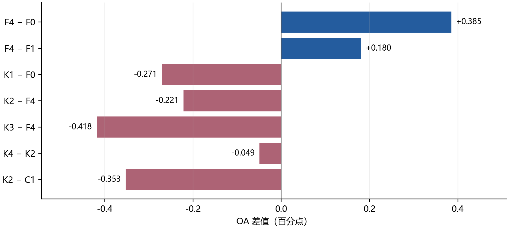
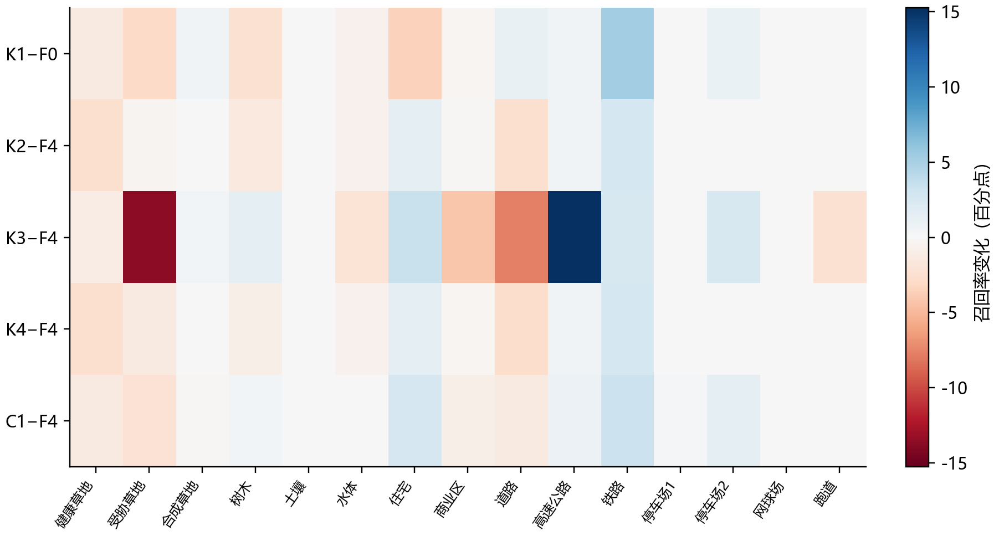
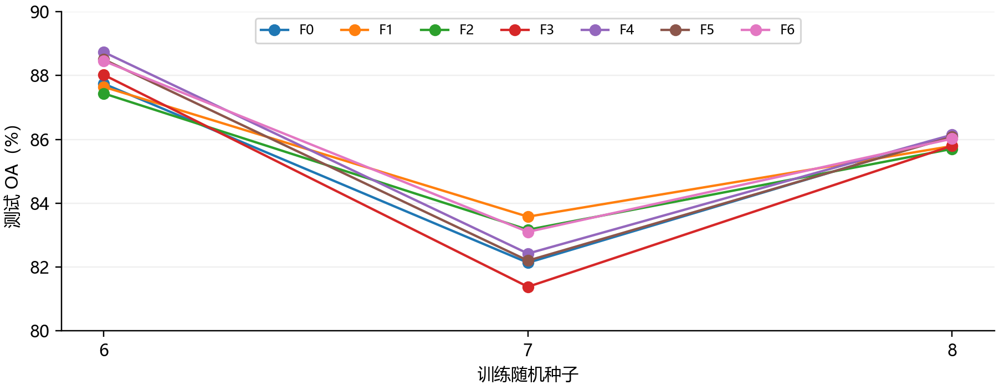

# TransMixer 周末融合与知识蒸馏实验全面报告

生成依据：2026-10-25T18:14:05.046932+08:00 的已核验汇总。

## 1 主要结论与实验边界

本报告汇总 2026 年 10 月 24 日至 25 日保存的 TransMixer 实验，回答直接融合能否复现约 89% 的历史准确率、跨模态交互是否有效，以及知识蒸馏能否进一步提高轻量学生网络。正式训练共 31 次，按两套选模规则分开评价。

四组蒸馏均未超过各自未蒸馏基线，本轮固定方案没有带来准确率提升。F4 向 RSCNet 蒸馏后 OA 下降 0.2214 个百分点，标签平滑相对 F4 为 +0.1312 个百分点。当前应保留轻量对照，暂不将普通蒸馏作为有效创新；这不等于否定所有可能的蒸馏方法。

| 问题 | 本轮证据 | 可以得出的结论 |
|---|---|---|
| 直接融合能否回到约 89% | F0 OA 88.8907%；相对历史 88.9727 为 -0.0820 个百分点 | 接近历史水平，未要求逐位一致 |
| 双向交互是否有效 | F4−F0 +0.3853；F4−F1 +0.1804 个百分点 | 本轮单种子描述性比较 |
| 蒸馏是否改善直接融合 | K1−F0 -0.2706 个百分点 | 下降 |
| 蒸馏是否改善交互模型 | K2−F4 -0.2214 个百分点 | 下降 |
| 是否超出标签平滑效果 | K2−C1 -0.3525 个百分点 | 只能评价本次固定配置 |

### 如何阅读这些分数

OA 是全部测试中心的正确率；AA 是 15 类召回率的平均值；Kappa 衡量扣除随机一致后的表现，本报告统一乘以 100。准确率的相减使用百分点。新蒸馏对照只有 seed6，且沿用实验室用测试 OA 保存 checkpoint 的规则，因此属于探索结果，不是独立测试或统计显著性证明。

本轮数据是 Houston2013 的 HSI 与 LiDAR。没有新增 Berlin 或 SAR 实验，不能将本报告的结论扩展到这些场景。

## 2 本周末做了哪些实验

| 批次 | 正式训练 | 数据与选模 | 用途 |
|---|---|---|---|
| 验证选模融合批次 | F0 至 F6 × seed6 7 8 共 21 次 | 2267 训练 565 验证 12197 测试；验证 OA 选模 | 比较融合方向与随机性 |
| 原实验室流程融合批次 | F0 F1 F4 共 3 次 | 2832 官方训练 12197 测试；测试 OA 选模 | 复现历史直接融合口径 |
| 新增教师与蒸馏批次 | T1 T2 K1 K2 K3 K4 C1 共 7 次 | 沿用上述原流程；seed6；每次 100 轮 | 教师选择 蒸馏 置信过滤及平滑对照 |

31 次只包含完成的正式训练。早期试启动 legacy_fusion_20261025_133300、合成输入检查、接口单元测试不计入训练总数。历史 9 月的单次成绩另列为背景，也不加入本周末统计。

### 原流程统一设置

| 设置 | 本轮固定值 |
|---|---|
| 输入与预处理 | PCA 30 维；11×11 窗口；全场景无标签 PCA 与标准化 |
| 训练预算 | 100 轮；batch128；drop_last=True；每轮 22 个批次 |
| 优化器 | 原 AdamW；学习率 0.0001；权重衰减 0.01 |
| 随机种子与线程 | seed6；OMP 与 MKL 线程均为 4 |
| 模型保存 | 沿用实验室测试 OA 最优 checkpoint；不追加轮数或测试推理 |
| 执行入口 | 原 scripts/train.py；原数据 训练和评估流程 |

两套协议的训练中心数、选模依据和数值设置不同。不能将验证批次的 85% 与原流程的约 89% 直接相减，并把差额归因于网络或某一个设置。所有模块效果都应使用同一批次内的对照。

## 3 你的网络和教师分别在做什么

### 直接融合与跨模态交互

B0 的 HSI 分支先通过 3D 卷积和投影，再进入 TransMixer。块内按通道分出全局注意力路径与局部深度卷积路径；辅助 LiDAR 分支主要是 2D 卷积，并不是与 HSI 完全对称的局部全局编码器。最终将两种模态的特征按通道拼接，用 1×1 卷积、池化与分类头输出。

F1 在辅助分支增加同类型自注意力，作为近似等参数容量对照。F4 在最终融合前加入双向交叉注意力，让 HSI 读取辅助信息，同时让辅助特征读取 HSI。两个方向都读取更新前特征，保留原融合头。F1 不严格匹配 F4 的全部计算量。

### 教师和学生的关系

教师是一张先独立训练好的分类网络。学生除了学习真实类别，还学习教师对 15 类给出的概率分布。例如教师把一个像素判断为道路 60%、高速公路 30%，它提供了这两类相似的信息。学生学习这种分布时仍保留真实标签损失，不是照抄教师的所有判断。

| 网络 | 训练时看到的输入 | 承担的角色 |
|---|---|---|
| B0 与 F4 学生 | PCA 后 HSI 加 LiDAR | 最终用于推理的轻量网络 |
| RSCNet 教师 T1 | 原始 144 波段 HSI 加 PCA HSI 加 LiDAR | 更丰富输入的训练指导 |
| CNN 教师 T2 | PCA 后 HSI 加 LiDAR | 与学生输入信息一致的教师对照 |

教师的权重与 BatchNorm 状态在学生训练中冻结，并读取同一个增强后的 batch。学生均从头训练 100 轮，没有使用旧学生 checkpoint 继续训练。推理时仅保留原 B0 或 F4；教师不进入学生模型文件。

RSCNet 与 CNN 的比较同时改变了网络结构和输入信息量。即使其中一位教师带来的收益更大，也不能只归因为该网络结构更适合蒸馏。

## 4 原版融合复现与历史结果

| 组 | 方法 | OA % | AA % | Kappa ×100 | 参数 |
|---|---|---|---|---|---|
| F0 | F0 原版直接融合 | 88.8907 | 90.5427 | 87.9355 | 80,887 |
| F1 | F1 辅助分支自增强 | 89.0957 | 90.7708 | 88.1594 | 97,656 |
| F4 | F4 整体双向交互 | 89.2761 | 90.9362 | 88.3540 | 97,657 |

| 同批对照 | OA 差值 百分点 | 解释 |
|---|---|---|
| F1−F0 | +0.2050 | 额外辅助变换带来的变化 |
| F4−F0 | +0.3853 | 交互方案相对直接融合的总变化 |
| F4−F1 | +0.1804 | 交互相对容量对照的变化 |

F0 的 88.8907% 与历史 88.9727% 接近，相差 -0.0820 个百分点。这回应了之前为何约为 89% 的问题：在恢复原 2832 个训练中心和原选模流程后，原模型确实回到了相近区间。但多个设置一起恢复，尚未逐项分离各设置的影响。

### 历史单次结果仅作为背景

| 历史记录 | OA % | 证据边界 |
|---|---|---|
| 2026 年 9 月直接融合 B0 | 88.9727 | 历史会话保留的标准报告输出 |
| B1 局部残差 | 88.9399 | 历史单次特征提取消融 |
| B2 SSM 前残差 | 88.9317 | 历史单次特征提取消融 |
| B3 步长初始化 | 88.4644 | 历史单次特征提取消融 |
| B4 多尺度深度卷积 | 88.9891 | 相对旧 B0 约 +0.0164 个百分点 |

这些旧记录不能并入本轮配对均值。B4 的极小单次差值并未证明稳定收益。关于历史 CNN 89.60% 与 RSCNet 90.01% 的记录，本轮已有重新训练的教师结果，下一页将以本轮实际值评价，避免把历史分数当作当前教师能力。

## 5 两位教师的实际表现

| 组 | 方法 | OA % | AA % | Kappa ×100 | 参数 |
|---|---|---|---|---|---|
| T1 | RSCNet 教师 | 91.6373 | 92.4472 | 90.9206 | 3,339,493 |
| T2 | CNN 教师 | 89.6040 | 91.0502 | 88.7088 | 548,751 |
| F0 | F0 原版直接融合 | 88.8907 | 90.5427 | 87.9355 | 80,887 |
| F4 | F4 整体双向交互 | 89.2761 | 90.9362 | 88.3540 | 97,657 |

| 教师对照 | OA 差值 百分点 | 解读 |
|---|---|---|
| T1 RSCNet−F4 | +2.3612 | 主教师相对交互学生的独立分类表现 |
| T2 CNN−F4 | +0.3279 | 同输入教师相对交互学生的表现 |
| T1−T2 | +2.0333 | 含结构与输入信息量的共同差异 |

两位教师在学生训练前分别完成 100 轮训练，并固定 checkpoint。教师选择基于实验室已有实现与历史记录；温度、权重和对照组在新结果出来前已经固定，没有依据学生测试成绩更换教师或搜索参数。

教师独立准确率高，并不保证它传给学生的概率分布最容易学习；反过来，一位教师未超过学生，也不能提前保证蒸馏有益。是否值得使用，须看对应学生与不蒸馏基线的差值，并结合标签平滑对照。

### 模型大小和部署代价

本地 RSCNet 有 3,339,493 个参数，CNN 有 548,751 个。这里是本地实现的实际计数，不能替换成原论文参数数目。B0 学生为 80,887 个参数，F4 为 97,657 个。蒸馏后的学生与各自未蒸馏版本参数量相同。

这种方法把额外成本放在训练阶段：先训练教师，再在学生每一步计算教师输出。本轮没有开展标准化推理计时，因此只能确认学生结构和参数量没有增加，不能进一步声称实际时延或能耗完全不变。

## 6 新增蒸馏对照如何设计

| 组 | 学生与训练方法 | 主要回答的问题 |
|---|---|---|
| K1 | B0 向 RSCNet 蒸馏 | 直接融合能否单独受益 |
| K2 | F4 向 RSCNet 蒸馏 | 交互与蒸馏能否一起使用 |
| K3 | F4 向 CNN 蒸馏 | 教师选择是否影响效果 |
| K4 | F4 只学习高置信 RSCNet 输出 | 过滤不确定输出是否有帮助 |
| C1 | F4 标签平滑 无教师 | 收益是否也能由简单正则化获得 |

### 固定损失和参数

普通组使用 L = CE + 0.3 × T² × KL，其中 T=4，KL 的方向是教师分布对学生分布。CE 让学生遵守真实标签；KL 让学生学习教师概率之间的关系；温度提高后，原本很小的类别概率更容易被学生观察到。

K4 以温度 1 下教师最大概率是否达到 0.7 作为门槛，只在接受的样本上平均 KL。若一个 batch 全部不接受，则只使用 CE。这是置信过滤，不保证排除所有错误：教师也可能自信地预测错误。C1 使用 epsilon=0.1 的标签平滑，让真实标签保留较高权重，其他类别也获得少量目标概率。

### 保留实验室流程

训练器仅增加可选损失回调和结束诊断回调；默认训练仍使用原 CE。优化器仍只接收学生参数，数据增强、训练循环、测试、checkpoint 规则均沿用原流程。蒸馏系数、温度和阈值没有按测试分数继续调整。

10 项接口测试与原生模型 GPU 预检已在正式蒸馏前通过，覆盖 KL 方向与温度缩放、零蒸馏权重、全拒绝、教师无梯度、配置兼容和保存恢复。它们验证实现能按设计运行，不代替性能实验。蒸馏公式参考 Hinton 等的原始工作，来源列于末页。

## 7 新增蒸馏实验的完整结果

| 组 | 方法 | OA % | AA % | Kappa ×100 | 参数 |
|---|---|---|---|---|---|
| F0 | F0 原版直接融合 | 88.8907 | 90.5427 | 87.9355 | 80,887 |
| F4 | F4 整体双向交互 | 89.2761 | 90.9362 | 88.3540 | 97,657 |
| K1 | B0 + RSC 蒸馏 | 88.6202 | 90.3717 | 87.6429 | 80,887 |
| K2 | F4 + RSC 蒸馏 | 89.0547 | 90.7252 | 88.1150 | 97,657 |
| K3 | F4 + CNN 蒸馏 | 88.8579 | 90.5645 | 87.9154 | 97,657 |
| K4 | F4 + RSC 置信过滤 | 89.0055 | 90.6879 | 88.0616 | 97,657 |
| C1 | F4 + 标签平滑 | 89.4072 | 91.0987 | 88.4977 | 97,657 |

四组蒸馏均未超过各自未蒸馏基线，本轮固定方案没有带来准确率提升。F4 向 RSCNet 蒸馏后 OA 下降 0.2214 个百分点，标签平滑相对 F4 为 +0.1312 个百分点。当前应保留轻量对照，暂不将普通蒸馏作为有效创新；这不等于否定所有可能的蒸馏方法。

K3 相对 F4 为 -0.4181 个百分点。K4 相对普通 RSC 蒸馏 K2 为 -0.0492 个百分点。负值意味着该固定设置没有得到更高 OA，不能将失败组从报告中移除。AA 和 Kappa 同时列出，避免只看 OA 忽略类别不均衡。

## 8 收益能归因于什么

| 关键比较 | OA 差值 百分点 | 能够检验的范围 |
|---|---|---|
| K1−F0 | -0.2706 | RSC 蒸馏对直接融合的效果 |
| K2−F4 | -0.2214 | RSC 蒸馏对交互模型的效果 |
| K2−K1 | +0.4345 | 在相同教师指导下两种学生的差异 |
| K2−K3 | +0.1968 | 两种教师的实用效果差异 |
| K4−K2 | -0.0492 | 当前置信过滤规则的效果 |
| K2−C1 | -0.3525 | 教师目标相对标签平滑的效果 |

不能只凭“蒸馏后超过旧 B0”就认定蒸馏和交互都有效。K2 与 F4 控制学生结构，K1 与 F0 检查无交互时是否也受益；K2 与 K1 则反映有教师条件下，F4 相对 B0 的表现。它们共同帮助分离不同因素，但单次结果仍不能证明稳定的机制贡献。

### 过滤实际启用了多少

K4 在全部增强训练样本中的接受比例为 100.00%，没有拒绝任何样本，因此本轮 0.7 阈值并未形成有效过滤。教师在这些训练 batch 上的正确率也是 100%，不能用它推断未见区域的可靠性。K4 与 K2 实际使用相同目标，二者 -0.0492 个百分点的差别不能解释为门控收益。旧流程没有采用严格确定性设置，具体数值差异来源未单独定位。

| 组 | 平均 CE | 平均 KD | 教师输出接受率 |
|---|---|---|---|
| K1 | 0.49001 | 2.08246 | 100.00% |
| K2 | 0.48743 | 2.07328 | 100.00% |
| K3 | 0.58461 | 10.06234 | 100.00% |
| K4 | 0.48754 | 2.07347 | 100.00% |
| C1 | 0.96243 | 0.00000 | 无教师 |

标签平滑是实用的软目标正则化对照，不能严格匹配教师 KL 的所有梯度。本轮它优于四种蒸馏学生，但仍只增加了单次的小幅 OA，不能据此认定稳定有效。常规 KL 蒸馏和双向交互本身已有研究基础，不能仅因把两者组合就宣布论文创新成立。

## 9 哪些类别受益和受损

| 类别 | F4 召回率 | K2 召回率 | K2−F4 百分点 |
|---|---|---|---|
| 铁路 | 94.9715 | 97.6281 | +2.6565 |
| 住宅 | 82.7425 | 84.1418 | +1.3993 |
| 高速公路 | 67.6641 | 68.2432 | +0.5792 |
| 树木 | 81.4394 | 79.9242 | -1.5152 |
| 道路 | 94.7120 | 92.2568 | -2.4551 |
| 健康草地 | 80.1519 | 77.6828 | -2.4691 |

表中选取 K2−F4 排名前三与末三的类别，选择规则明确；完整 15 类指标保存在逐类召回率.csv。颜色表示召回率变化，不能解释为同一像素被纠正的比例，因为本报告复核的是混淆矩阵，没有重新运行推理或逐样本配对纠错。

如果 OA 增加而某些类别下降，应如实保留。AA 有助于观察各类平均表现，但也不能替代具体业务类别要求。这里的类别分析是在看过测试结果后进行，只能为下一轮假设提供线索，不能反过来据此选择阈值并声称独立验证。

## 10 验证选模的三种子融合实验

| 组 | 方法 | OA 均值±样本SD | AA 均值 | Kappa 均值 | 相对 F0 |
|---|---|---|---|---|---|
| F0 | 原始拼接 | 85.327 ± 2.883 | 87.738 | 84.067 | +0.000 |
| F1 | 辅助自增强（容量对照） | 85.671 ± 2.036 | 88.035 | 84.441 | +0.344 |
| F2 | 辅助→HSI | 85.436 ± 2.148 | 87.795 | 84.184 | +0.109 |
| F3 | HSI→辅助 | 85.067 ± 3.381 | 87.549 | 83.785 | -0.260 |
| F4 | 整体双向交互 | 85.767 ± 3.173 | 88.090 | 84.544 | +0.440 |
| F5 | 全局/局部分工交互 | 85.595 ± 3.180 | 87.965 | 84.357 | +0.268 |
| F6 | 交换分工对照 | 85.860 ± 2.681 | 88.193 | 84.645 | +0.533 |

该批 F4−F0 平均为 +0.440 个百分点，三个种子均为正；F4−F1 平均仅 +0.096，2 胜 1 负。F4 的 OA 标准差 3.173 大于 F0 的 2.883，不能说 F4 整体更稳定。F5 比交换分工 F6 平均低 0.265，当前实现没有支持原全局局部分工假设。

565 个验证中心均落在某个训练窗口内，验证窗口也均与训练窗口相交；21 次中 20 次最佳验证 OA 达到 100%。窗口重叠本身不等于使用测试标签，但说明随机验证过易。原流程则直接用测试 OA 选模；两套规则各有限制，都没有完成空间隔离的独立泛化确认。

## 11 训练代价和科研定位

| 新增组 | 包含启动与预处理的作业耗时 | 模型推理参数 |
|---|---|---|
| T1 | 8.3 分钟 | 3,339,493 |
| T2 | 5.0 分钟 | 548,751 |
| K1 | 32.6 分钟 | 80,887 |
| K2 | 32.9 分钟 | 97,657 |
| K3 | 29.6 分钟 | 97,657 |
| K4 | 28.2 分钟 | 97,657 |
| C1 | 26.4 分钟 | 97,657 |

新增 7 个作业总墙钟时间约 2.72 小时，包括读取数据、PCA、每轮测试、保存模型和启动开销。它不是纯 GPU 计算时间，不宜与旧批次记录的训练时间直接相除。教师训练及教师前向均为新增成本。

### 现在可以怎样汇报

在 Houston2013 原实验室流程的 seed6 对照中，F4 相对直接融合提高 +0.3853 个百分点，相对容量对照提高 +0.1804；RSC 蒸馏 K2 相对 F4 为 -0.2214，相对标签平滑为 -0.3525。学生参数量保持不变。以上为探索结果，选模使用测试集，尚不能称为统计显著或 SOTA。

### 后续研究优先级

先确认最值得保留的固定方法能否在新的预设种子与空间分组验证下复现，再考虑跨数据集。若蒸馏与标签平滑持平，应优先保留更简单的方案；若置信过滤无收益，不继续堆叠相近门控。若教师明显更强而学生未改善，应先检查容量与软目标可学习性，不应直接更换大量超参数试到提升。

本报告不自动追加这些训练。可发展的具体问题是轻量且不对称的模态分支如何避免传递不可靠信息，而非笼统地“加交互”或“加蒸馏”。已有分数只能帮助筛选假设，机制解释仍需要预先设计的可靠性对照。

## 12 数据来源与复核索引

### 本地证据

周末实验总汇.json 保存十组原流程指标、对照差值、21 次验证批次统计和核验结果。原流程十组结果.csv 可用于排序；逐类召回率.csv 保存完整类别比较；原始证据索引.csv 保存每组报告、checkpoint、配置及 SHA256。所有文件位于本报告所在目录。

原三方法在加入蒸馏接口前已经封存，证据为原三方法最终验收.json。蒸馏批次的 manifest.json 保存接入后源码指纹；接入前原代码与蒸馏接口接入记录.json 保留修改记录。两批源码时期不同，不应因后续合法修改误判旧训练失真。

新增七组均已核对原标准日志中的 100 轮完成记录、checkpoint 和 15×15 混淆矩阵。OA、AA、Kappa 由矩阵重新计算，每份测试总数均为 12197。五个学生对照均记录 2200 个损失步骤、281600 个增强样本；教师参数和 BN 状态不变、无梯度，且不进入学生 checkpoint。

### 历史和论文来源

历史 B0 与 B1 至 B4 背景来自本项目先前的综合评估报告及其证据目录，原路径 report/综合评估_20261025。历史 B0 的原始 checkpoint 尚未找回，不视为本轮重复训练。

蒸馏原始论文：Hinton G 等，Distilling the Knowledge in a Neural Network，2015。https://arxiv.org/abs/1503.02531

KL 实现接口：PyTorch functional.kl_div 官方文档。https://docs.pytorch.org/docs/stable/generated/torch.nn.functional.kl_div.html

公开方法对照与既有交互文献详见先前综合评估报告。本轮 RSCNet 和 CNN 表格为本地实测；没有将论文作者分数混作本地 SOTA 排名。

### 仍未获得的证据

尚无蒸馏的多种子确认、空间隔离验证、独立测试、Berlin 或 SAR 泛化结果；没有标准化推理时延或能耗测量。整份报告包含成功与失败组，未因指标高低删除实验。Word 与 PDF 需经渲染逐页检查后才交付。
